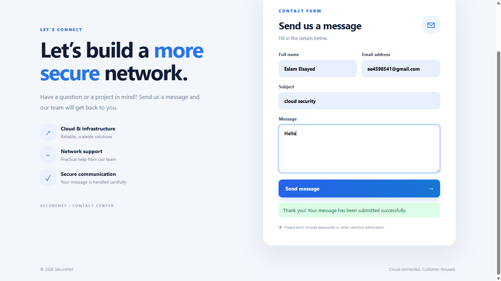
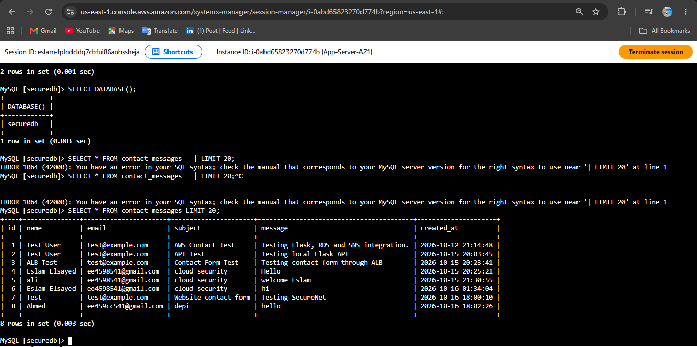
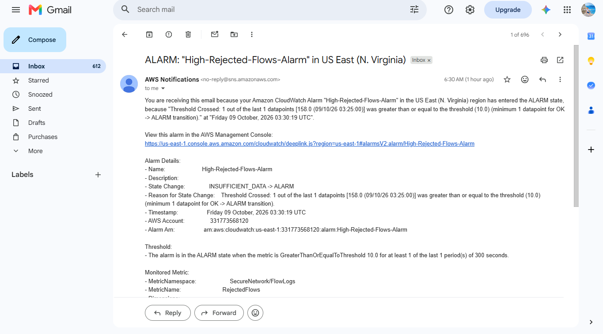
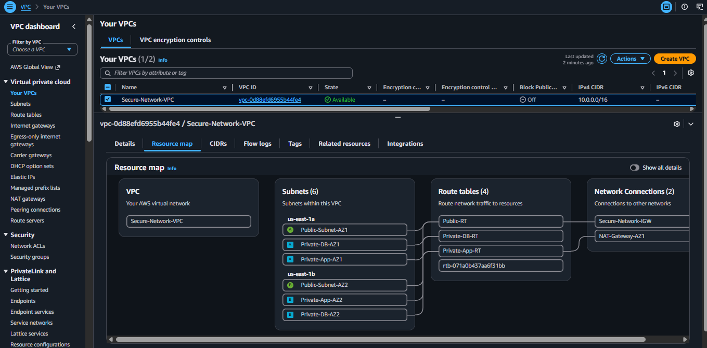
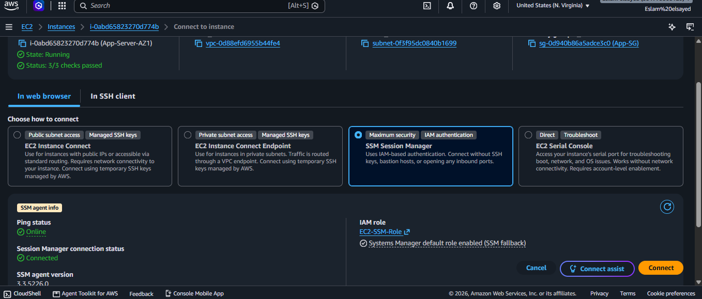

# SecureNet AWS Secure Contact Form

A secure, highly available, and monitored contact form application built using AWS services.

The project demonstrates how to deploy a web application using a secure AWS architecture with public and private subnets, load balancing, a private database, VPC endpoints, Systems Manager, CloudFront, WAF, SNS notifications, VPC Flow Logs, CloudWatch monitoring, and Transit Gateway connectivity.

---

## 1. Project Overview

SecureNet is a cloud-based contact form application.

Users access the website through CloudFront. The frontend is hosted in Amazon S3, while the backend API runs on EC2 instances inside private application subnets.

When a user submits the contact form:

1. The request reaches CloudFront.
2. The frontend sends the request to the backend API.
3. CloudFront routes the API request to the Application Load Balancer.
4. The ALB forwards the request to a healthy EC2 instance.
5. The Flask application validates the request.
6. The application stores the message in Amazon RDS MySQL.
7. After a successful database transaction, Amazon SNS sends a notification to the administrator.
8. Monitoring and logging services record infrastructure activity.

---

# 2. Architecture

```text
                         Internet
                            |
                            v
                     +--------------+
                     |  CloudFront  |
                     +------+-------+
                            |
                +-----------+-----------+
                |                       |
                v                       v
           Amazon S3                 Application
          Static Website                API
                |                       |
                |                 +-----v------+
                |                 |    ALB     |
                |                 +-----+------+
                |                       |
                |          +------------+------------+
                |          |                         |
                |          v                         v
                |     Private EC2 1             Private EC2 2
                |     Flask/Gunicorn             Flask/Gunicorn
                |          |                         |
                |          +------------+------------+
                |                       |
                |                       v
                |                 Amazon RDS
                |                   MySQL
                |                       |
                |                       v
                |                  SNS Topic
                |                       |
                |                       v
                |                Admin Notification


                 Secure-Network-VPC
                       10.0.0.0/16

          +--------------------------------------+
          |                                      |
          | Public Subnets                       |
          | 10.0.1.0/24                         |
          | 10.0.2.0/24                         |
          |                                      |
          | ALB / Internet-facing components    |
          |                                      |
          +--------------------------------------+

          +--------------------------------------+
          |                                      |
          | Private App Subnets                  |
          | 10.0.11.0/24                        |
          | 10.0.12.0/24                        |
          |                                      |
          | EC2 Flask Application                |
          |                                      |
          +--------------------------------------+

          +--------------------------------------+
          |                                      |
          | Private DB Subnets                   |
          | 10.0.21.0/24                        |
          | 10.0.22.0/24                        |
          |                                      |
          | RDS MySQL                            |
          |                                      |
          +--------------------------------------+
```

## 🏗️ Architecture


---

## 📸 Project Screenshots

### User interface


### Submit Notification


### RDS Table


### Cloudwatch


### Alarm Notification


### VPC Resource Map


### System Session Manager


---

# 3. AWS Services Used

| Service | Purpose |
|---|---|
| Amazon VPC | Network isolation |
| Public Subnets | Internet-facing components |
| Private App Subnets | EC2 backend servers |
| Private DB Subnets | RDS database |
| Internet Gateway | Internet connectivity for public resources |
| Application Load Balancer | Distribute traffic between EC2 instances |
| EC2 | Host Flask backend |
| RDS MySQL | Store contact messages |
| S3 | Host frontend files |
| CloudFront | CDN and secure frontend delivery |
| WAF | Web application protection |
| Shield | DDoS protection |
| IAM | Access control |
| Systems Manager | Secure EC2 administration |
| VPC Endpoints | Private access to AWS services |
| SNS | Administrator notifications |
| VPC Flow Logs | Network traffic logging |
| CloudWatch | Monitoring and alarms |
| Athena | Query VPC Flow Logs |
| Transit Gateway | Connect multiple VPC networks |

---

# 4. Network Design

## VPC

VPC name:

```text
Secure-Network-VPC
```

CIDR:

```text
10.0.0.0/16
```

The VPC provides the main network boundary for the application.

---

## Public Subnets

### Public Subnet 1

```text
10.0.1.0/24
Availability Zone: us-east-1a
```

### Public Subnet 2

```text
10.0.2.0/24
Availability Zone: us-east-1b
```

These subnets are used for public-facing infrastructure such as the Application Load Balancer.

---

## Private Application Subnets

### Private App Subnet 1

```text
10.0.11.0/24
Availability Zone: us-east-1a
```

### Private App Subnet 2

```text
10.0.12.0/24
Availability Zone: us-east-1b
```

EC2 backend servers are deployed here.

The EC2 instances do not need public IP addresses.

---

## Private Database Subnets

### Private DB Subnet 1

```text
10.0.21.0/24
Availability Zone: us-east-1a
```

### Private DB Subnet 2

```text
10.0.22.0/24
Availability Zone: us-east-1b
```

RDS is deployed using these private subnets.

The database is not directly accessible from the Internet.

---

# 5. Internet Gateway

An Internet Gateway is attached to the VPC.

It provides Internet connectivity for resources that are located in public subnets and have appropriate routing and security rules.

The route table for the public subnets contains:

```text
0.0.0.0/0 -> Internet Gateway
```

The private application and database subnets do not use a direct Internet Gateway route.

---

# 6. Route Tables

The architecture uses separate routing logic for public, application, and database resources.

## Public Route Table

```text
Destination: 10.0.0.0/16
Target: local

Destination: 0.0.0.0/0
Target: Internet Gateway
```

## Private Application Route Table

The application subnets use private routing.

AWS service access is provided using VPC endpoints where possible.

## Private Database Route Table

The database subnet remains isolated from direct Internet access.

---

# 7. Security Groups

Security groups are used to enforce least-privilege network communication.

## ALB Security Group

Allows HTTP/HTTPS traffic from the Internet as required by the application.

The ALB forwards traffic to the backend EC2 instances on:

```text
TCP 5000
```

---

## EC2 Security Group

The EC2 instances accept application traffic only from the ALB security group.

Application port:

```text
TCP 5000
```

SSH is not required for normal administration because AWS Systems Manager Session Manager is used.

---

## RDS Security Group

RDS accepts MySQL traffic only from the EC2 application security group.

```text
TCP 3306
Source: EC2 Security Group
```

The database is therefore not exposed directly to the Internet.

---

# 8. EC2 Backend

Two EC2 instances are used:

```text
10.0.11.131
10.0.12.251
```

The backend application is based on:

```text
Python
Flask
Gunicorn
```

The application is managed using systemd.

Service:

```text
contact-api.service
```

---

# 9. Backend Application

The Flask application exposes two main endpoints.

## Health Check

```http
GET /health
```

Example response:

```json
{
  "status": "healthy"
}
```

The ALB uses this endpoint for health checks.

---

## Contact API

```http
POST /api/contact
```

The endpoint receives contact form data.

The application:

1. Validates the input.
2. Connects to RDS.
3. Inserts the message.
4. Commits the transaction.
5. Publishes an SNS notification.
6. Returns the API response.

---

# 10. Environment Variables

The backend uses environment variables instead of hardcoding credentials.

Example:

```env
DB_HOST=your-rds-endpoint
DB_USER=admin
DB_PASSWORD=your-password
DB_NAME=securenet
DB_PORT=3306
AWS_REGION=us-east-1
SNS_TOPIC_ARN=your-sns-topic-arn
```

The `.env` file must never be committed to GitHub.

Only `.env.example` should be included in the repository.

---

# 11. Gunicorn

Gunicorn is used as the production WSGI server for Flask.

Example:

```bash
gunicorn --workers 3 --bind 0.0.0.0:5000 app:app
```

The application is managed by systemd so it can automatically start after reboot.

---

# 12. Application Load Balancer

The ALB distributes requests between the two EC2 instances.

Target Group:

```text
Protocol: HTTP
Port: 5000
Health Check Path: /health
```

The ALB only sends traffic to healthy targets.

ALB DNS:

```text
contactform-ALB-1366953573.us-east-1.elb.amazonaws.com
```

---

# 13. Amazon RDS

Database engine:

```text
MySQL
```

Database:

```text
securenet
```

Port:

```text
3306
```

Main table:

```text
contact_messages
```

The RDS instance is deployed in private database subnets.

The application connects to RDS using the internal RDS endpoint.

---

# 14. Database Security

The database is protected using network-level controls.

Only the EC2 application security group can connect to:

```text
TCP 3306
```

Users on the Internet cannot directly connect to RDS.

This reduces the attack surface and follows the principle of least privilege.

---

# 15. Amazon S3

S3 is used to host the static frontend.

Frontend files include:

```text
index.html
style.css
script.js
```

Example bucket:

```text
secure-network-origin-123
```

The bucket is used as the CloudFront origin.

---

# 16. CloudFront

CloudFront provides:

- CDN delivery
- HTTPS
- Edge caching
- Reduced latency
- Integration with AWS WAF
- Secure access to the S3 origin

CloudFront distribution:

```text
E1YUP14VLB6ENI
```

The frontend is accessed through CloudFront rather than directly exposing the S3 bucket.

---

# 17. AWS WAF

AWS WAF is used to protect the application from common web attacks.

WAF can inspect incoming HTTP/HTTPS requests and block malicious traffic.

Example protections include:

- SQL injection
- Cross-site scripting
- Malicious requests
- Abnormal request patterns
- Rate-based attacks

WAF is associated with the CloudFront distribution.

---

# 18. AWS Shield

AWS Shield provides DDoS protection for AWS resources.

CloudFront and AWS infrastructure already provide baseline DDoS protection, while Shield Advanced can provide additional protection and visibility when required.

---

# 19. AWS Systems Manager

Systems Manager Session Manager is used to access EC2 instances without opening SSH to the Internet.

This provides a more secure administration model.

Instead of:

```text
Internet -> SSH -> EC2
```

the architecture uses:

```text
Administrator
     |
     v
Systems Manager
     |
     v
Private EC2
```

---

# 20. VPC Endpoints

VPC endpoints allow private communication between resources inside the VPC and AWS services.

Configured endpoints include Systems Manager endpoints:

```text
com.amazonaws.us-east-1.ssm
com.amazonaws.us-east-1.ssmmessages
```

An S3 Gateway Endpoint is also configured.

The purpose is to reduce the need for Internet/NAT connectivity when accessing supported AWS services.

---

# 21. VPC Flow Logs

VPC Flow Logs capture network traffic information from the VPC.

They help with:

- Troubleshooting
- Security investigation
- Network visibility
- Traffic analysis

Flow Logs are delivered to S3.

---

# 22. Athena

Amazon Athena can query the VPC Flow Logs stored in S3 using SQL.

This allows network traffic to be analyzed without moving the logs to another database.

Example analysis:

```sql
SELECT *
FROM flow_logs
LIMIT 20;
```

Athena can be used to investigate rejected traffic, source IPs, destination ports, and network communication patterns.

---

# 23. CloudWatch Monitoring

CloudWatch is used to monitor the application and AWS infrastructure.

Important metrics include:

- EC2 CPU utilization
- ALB request count
- ALB response errors
- Target health
- RDS CPU utilization
- RDS connections
- Network activity

CloudWatch alarms can notify administrators when a metric exceeds a defined threshold.

---

# 24. SNS Notifications

Amazon SNS is used to notify the administrator after a contact form submission.

The application publishes a message to:

```text
SecureNet-Admin-Notifications
```

The notification is sent after the database transaction succeeds.

This design prevents an SNS failure from causing the database transaction to be rolled back.

---

# 25. Transit Gateway

AWS Transit Gateway is used to demonstrate centralized connectivity between VPC networks.

Main VPC:

```text
10.0.0.0/16
```

Connected VPC:

```text
10.1.0.0/16
```

Transit Gateway provides centralized routing between the VPCs.

It is useful when an architecture grows to multiple VPCs.

---

# 26. End-to-End Request Flow

When a user submits the contact form:

```text
User
 |
 v
CloudFront
 |
 v
Frontend
 |
 v
ALB
 |
 v
Healthy EC2
 |
 v
Flask API
 |
 +----> RDS MySQL
 |
 +----> SNS
          |
          v
       Admin
```

The database stores the message, while SNS sends the administrator notification.

---

# 27. Testing

## Test ALB Health

```bash
curl http://<ALB-DNS>/health
```

Expected:

```json
{
  "status": "healthy"
}
```

## Test Backend

```bash
curl -X POST http://<ALB-DNS>/api/contact \
-H "Content-Type: application/json" \
-d '{"name":"Test User","email":"test@example.com","message":"Hello SecureNet"}'
```

## Verify RDS

Check:

```text
contact_messages
```

and verify that the submitted message exists.

## Verify SNS

Verify that the administrator receives the notification.

---

# 28. Security Principles Used

The project follows several AWS security principles:

### Least Privilege

Security groups only allow required communication.

### Network Segmentation

Public, application, and database resources are separated.

### Private Database

RDS is not publicly accessible.

### No Public EC2 Access

EC2 instances are managed through Systems Manager.

### Secure Secrets

Database credentials are stored as environment variables and excluded from Git.

### Defense in Depth

The project uses:

```text
Security Groups
+
Private Subnets
+
CloudFront
+
WAF
+
Shield
+
VPC Endpoints
+
IAM
+
Flow Logs
+
CloudWatch
```

---

# 29. Project Structure

```text
SecureNet-AWS-Secure-Contact-Form/
│
├── README.md
│
├── frontend/
│   ├── index.html
│   ├── style.css
│   └── script.js
│
├── backend/
│   ├── app.py
│   ├── requirements.txt
│   ├── .env.example
│   └── systemd/
│       └── contact-api.service
│
├── guided/
│   ├── 00-resource-reference.md
│   ├── 01-project-overview.md
│   ├── 02-vpc-and-subnets.md
│   ├── 03-security-groups-and-routing.md
│   ├── 04-ec2-backend.md
│   ├── 05-alb.md
│   ├── 06-rds.md
│   ├── 07-s3-cloudfront-waf.md
│   ├── 08-ssm-and-vpc-endpoints.md
│   ├── 09-flow-logs-athena-cloudwatch.md
│   ├── 10-sns.md
│   ├── 11-transit-gateway.md
│   ├── 12-testing.md
│   └── 13-interview-questions.md
│
└── images/
    ├── architecture.svg
    └── README.md
```

---

# 30. Technologies

- AWS
- Amazon VPC
- Amazon EC2
- Application Load Balancer
- Amazon RDS MySQL
- Amazon S3
- Amazon CloudFront
- AWS WAF
- AWS Shield
- AWS Systems Manager
- Amazon SNS
- Amazon CloudWatch
- Amazon Athena
- AWS Transit Gateway
- Python
- Flask
- Gunicorn
- MySQL
- Linux
- Git & GitHub

---

# 31. Key Learning Outcomes

Through this project, the following concepts were practiced:

- AWS VPC design
- Public/private subnet architecture
- Routing
- Security Groups
- EC2 deployment
- Flask backend deployment
- Gunicorn
- systemd
- Application Load Balancer
- RDS
- S3
- CloudFront
- WAF
- Shield
- Systems Manager
- VPC Endpoints
- SNS
- VPC Flow Logs
- Athena
- CloudWatch
- Transit Gateway
- AWS security best practices
- Troubleshooting network connectivity

---

# 32. Author

**Eslam Elsayed**

Communications and Networks Engineering Student  
Cloud Computing & AWS Security Trainee

Focus:

- AWS Cloud
- Cloud Security
- Networking
- Infrastructure
- Troubleshooting
- Secure Cloud Architecture
